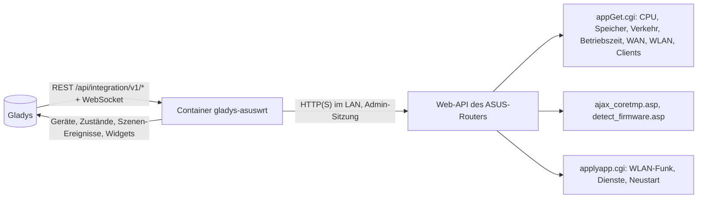
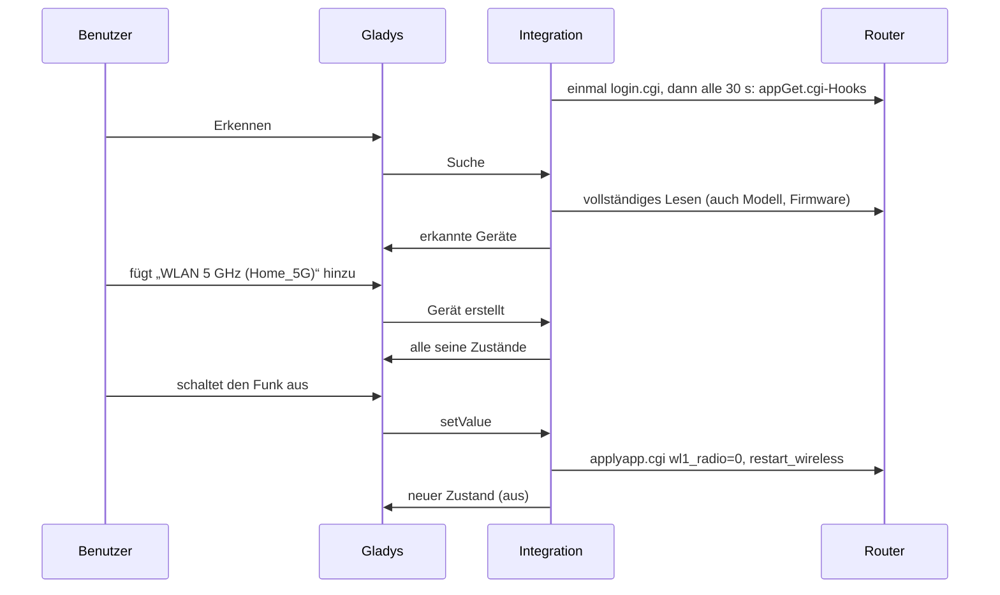
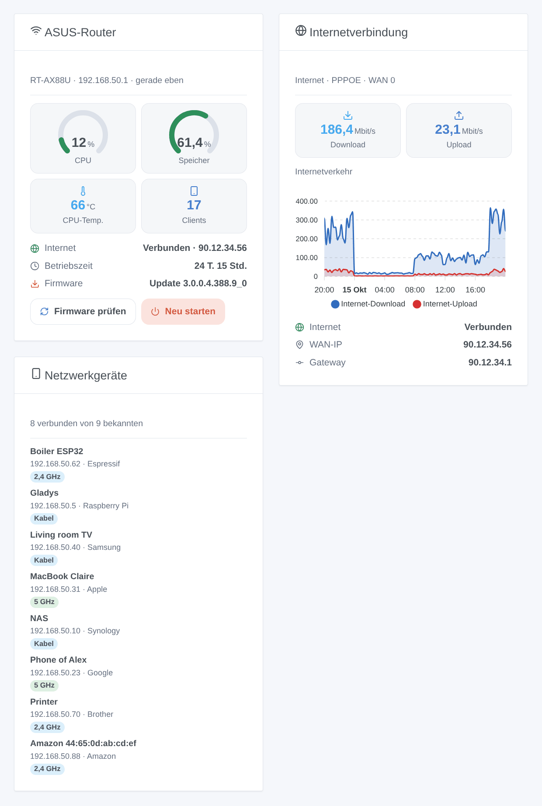

# Gladys ASUSWRT

[English](README.md) · [Français](README.fr.md) · **Deutsch** · [Español](README.es.md)

[](LICENSE)
[](https://github.com/William-De71/gladys-asuswrt/releases)
[](https://github.com/William-De71/gladys-asuswrt/actions/workflows/release.yml)
[](https://gladysassistant.com)


Externe Integration für [Gladys Assistant](https://gladysassistant.com) für **ASUS-Router** (Original-Firmware ASUSWRT und Asuswrt-Merlin): der Zustand des Routers, seine Internetverbindung, seine WLAN-Funkmodule, die Geräte in Ihrem Netzwerk, Szenen und Dashboard-Widgets. Alles läuft über die Weboberfläche des Routers in Ihrem lokalen Netzwerk, mit seinem Administratorkonto: keine Cloud.

Benutzerdokumentation: [English](docs/en.md) · [Français](docs/fr.md) · [Deutsch](docs/de.md) · [Español](docs/es.md).

> Community-Integration, weder mit ASUSTeK Computer Inc. noch mit dem Projekt Asuswrt-Merlin verbunden oder von ihnen unterstützt.

## Funktionen

- Gerät **Router**: CPU- und Speicherauslastung, Temperaturen (CPU und jedes Funkmodul, das der Router meldet), Betriebszeit, Download- und Upload-Rate des Internets, Internetstatus, WAN-IP-Adresse, verbundene Clients, Firmware-Version.
- Ein **Schalter pro WLAN-Funkmodul** (2,4 GHz, 5 GHz, 6 GHz): Schalten Sie das 5-GHz-WLAN nachts per Szene ab.
- **Anwesenheit** der Geräte Ihres Netzwerks, aus der Client-Liste des Routers, mit einer Abwesenheitsverzögerung (wie die Geräteverfolgung von Home Assistant).
- **5 Szenen-Auslöser**, **4 Szenen-Aktionen** und **3 Dashboard-Widgets** (unten).
- Überall vier Sprachen: Englisch, Französisch, Deutsch, Spanisch.

## Funktionsweise




Von der Suche zum Befehl:



Der Router-Client ist eine JavaScript-Neufassung nach der Python-Bibliothek [asusrouter](https://github.com/Vaskivskyi/asusrouter) (Apache 2.0), der HTTP-Bibliothek der ASUSWRT-Integration von Home Assistant. Der SSH-/Telnet-Modus von Home Assistant wird nicht unterstützt.

### Transport

`transports: ["local"]`: Die Integration spricht nur mit der Weboberfläche des Routers, per HTTP oder HTTPS in Ihrem Netzwerk. Bei HTTPS wird das Zertifikat geprüft, wenn Sie „Zertifikat prüfen“ ankreuzen (der Router wird mit einem selbstsignierten ausgeliefert). Keine Daten verlassen Ihr Netzwerk; der Router selbst kontaktiert bei einer Firmware-Prüfung den Update-Server von ASUS.

## Geräte und Funktionen

| Gerät          | Funktionen (Kategorie / Typ)                                                                                                                                                                                                                    |
| -------------- | ----------------------------------------------------------------------------------------------------------------------------------------------------------------------------------------------------------------------------------------------- |
| ASUS-Router    | CPU, Speicher (`level-sensor` %), Temperaturen (`device-temperature-sensor`), Betriebszeit (`duration`, Tage), Download und Upload (`datarate`, Mbit/s), Internet und WAN-IP (`text`), verbundene Clients (`counter-sensor`), Firmware (`text`) |
| WLAN-Funkmodul | Funk (`switch` / `binary`, ein Befehl: Der Router startet sein WLAN neu, um ihn anzuwenden)                                                                                                                                                     |
| Netzwerkgerät  | Anwesenheit (`presence-sensor` / `push`, 1 jede Minute solange anwesend, 0 nach dem Gehen)                                                                                                                                                      |

Externe IDs beruhen auf stabilen Kennungen: `main` für den Router, die Funkeinheit (`wl0`, `wl1`…) für ein Funkmodul, die MAC-Adresse für einen Client.

## Szenen-Auslöser, Aktionen und Widgets



**Widgets**: ASUS-Router (CPU- und Speicheranzeige, Temperatur, Clients, Internet, Betriebszeit, Firmware, Schaltflächen „Firmware prüfen“ und „Neu starten“), Internetverbindung (Raten, Verkehrsdiagramm sobald das Router-Gerät hinzugefügt ist, Status, WAN-Adresse), Netzwerkgeräte (verbunden, gegangen oder alle, mit ihrer Verbindung).

**Auslöser**: Internet weg oder zurück, Gerät gekommen oder gegangen, neues Gerät im Netzwerk (einmal pro MAC-Adresse, in `/data` gespeichert), Router neu gestartet, Firmware-Update verfügbar.

**Aktionen**: Status lesen, einen Dienst neu starten (WLAN, Internetverbindung, DNS / DHCP), nach einem Firmware-Update suchen, neu starten.

Beispiele:

- Wenn das Internet ausfällt → die smarte Steckdose der Box aus- und nach 10 s wieder einschalten.
- Wenn das Telefon eines Kindes ins Netzwerk kommt → das Licht im Flur einschalten und eine Nachricht senden.
- Wenn ein neues Gerät im Netzwerk erscheint → seinen Namen, Hersteller und seine IP an den Administrator senden.

Eine Änderung durch Gladys selbst (ein umgeschaltetes Funkmodul, ein Neustart oder eine Prüfung aus Gladys) löst nie einen Auslöser aus.

## Voraussetzungen

- Gladys Assistant **5.1.0** oder neuer (Widgets und Szenen): Ältere Instanzen können die Integration nicht installieren.
- Ein ASUS-Router mit der ASUSWRT-Weboberfläche (Original-Firmware 3.0.0.4.386 oder neuer, 3.0.0.6, oder Asuswrt-Merlin) im Router-Modus und sein Administratorkonto. AiMesh-Knoten werden aus der Client-Liste ausgeschlossen (der Hauptrouter kennt alle Clients).

## Installation

- **Aus dem Store**: Integrationen → ASUSWRT → Installieren.
- **Über die Repository-URL**: Integrationen → externe Integration → `https://github.com/William-De71/gladys-asuswrt`.
- **Entwicklermodus**: Starten Sie `npm start` mit den von Gladys gelieferten Variablen (siehe Entwicklung).

## Konfiguration

| Feld                      | Standard    | Bedeutung                                                          |
| ------------------------- | ----------- | ------------------------------------------------------------------ |
| Adresse des Routers       | —           | `192.168.50.1` (http) oder `https://192.168.50.1:8443` mit HTTPS   |
| Benutzername / Passwort   | —           | Das Administratorkonto des Routers (das Passwort ist ein `secret`) |
| Zertifikat prüfen         | aus         | Nur HTTPS: mit einem gültigen Zertifikat ankreuzen                 |
| Leseintervall             | 30 s        | 10 bis 300 s                                                       |
| Angebotene Netzwerkgeräte | mit Namen   | mit Namen, alle, keine                                             |
| Abwesenheitsverzögerung   | 5 Min.      | 1 bis 60 Min.                                                      |
| Sprache der Texte         | automatisch | Namen, Zustände und Szenen-Zusammenfassungen                       |

## Verwendung

1. Füllen Sie die Konfiguration aus und klicken Sie auf **Verbindung testen**.
2. **Erkennen** Sie, und fügen Sie den Router, die WLAN-Funkmodule und die gewünschten Netzwerkgeräte hinzu.
3. Fügen Sie die Widgets einem Dashboard hinzu und erstellen Sie Szenen mit den Auslösern und Aktionen.

## Entwicklung

```bash
npm install
npm test                       # node --test, nie mit dem Netzwerk
npm run lint                   # ESLint
npm run format:check           # Prettier
npx github:GladysAssistant/integration-store . --skip-image-check
scripts/build-cover.sh         # cover.jpg aus docs/assets/cover.svg
docs/illustrations/render.sh   # docs/assets/widgets.<sprache>.png
```

Lokal liest das SDK `GLADYS_HOST_API_URL`, `GLADYS_INTEGRATION_TOKEN` und `GLADYS_INTEGRATION_SELECTOR` (von Gladys im Entwicklermodus geliefert). `DEBUG=gladys-integration-sdk` zeigt die Protokolle des SDK.

Die Tests decken den Router-Client ab (Anmeldung, gehaltene Sitzung, abgelaufene Sitzung, falsches Passwort, Anmeldesperre), das Lesen echter Router-Antworten (Aufzeichnungen der Bibliothek asusrouter, fehlerhaftes JSON alter Firmwares), die Übergänge und die Anwesenheit, die Geräte (die vom Erkennungsbildschirm verlangten Felder), die Widgets (`validateWidgetContent`), die Szenen-Ereignisse und -Ausgaben, das Manifest, die vier Sprachen, das Release-Skript und die ganze Integration gegen das Fake-Gladys des SDK und einen Fake-Router. `test/structure.test.js` friert alle bei Benutzern gespeicherten Schlüssel ein.

## Release-Prozess


Jeder Merge auf `main` startet die CI und berechnet dann die Version aus den [Conventional Commits](https://www.conventionalcommits.org/de/) seit dem letzten Tag: `feat` → Minor, `fix` / `perf` → Patch, `!` oder `BREAKING CHANGE` → Major (unter 1.0.0 ein Minor); `docs`, `chore`, `ci`, `test`, `style`, `refactor`, `build` allein veröffentlichen nichts. Der Changelog-Abschnitt wird erzeugt, der Tag gepusht, das Multi-Architektur-Image gebaut, dann erhält `main` den Release-Commit, das GitHub Release wird erstellt und ein letzter Job prüft das öffentliche Image, den Store-Validator und das Topic.

- Der Titel des Pull Requests wird zum Squash-Commit und dann zur Changelog-Zeile: auf Englisch, für den Benutzer schreiben (`pr-title.yml` prüft ihn). `CHANGELOG.md` nie von Hand bearbeiten.
- 1.0.0 ist eine Entscheidung: Actions → Release → Run workflow mit `release-as: 1.0.0`. `dry-run` zeigt Version und Notizen, ohne zu veröffentlichen.
- **Geschützter Branch**: Das Release pusht seinen Commit mit `GITHUB_TOKEN` auf `main`. Mit einem Ruleset auf `main` GitHub Actions in die Bypass-Liste aufnehmen (oder über eine GitHub App pushen), sonst schlägt der Veröffentlichungs-Job mit Hinweisen fehl.
- Nach dem ersten Release das Paket `ghcr.io` öffentlich machen (Package settings → Change visibility), sonst kann Gladys es nicht laden.

## Fehlerbehebung

Siehe [docs/de.md](docs/de.md#fehlerbehebung). Melden Sie Probleme mit den Versionen von Gladys und der Integration, Modell und Firmware des Routers sowie den Protokollen der Integration.

## Mitwirken

Issues und Pull Requests sind willkommen. Führen Sie vor einem Pull Request `npm run format:check && npm run lint && npm test` aus und lassen Sie alle externen IDs und gespeicherten Schlüssel unverändert (siehe [CLAUDE.md](CLAUDE.md)).

## Sicherheit

Siehe [SECURITY.md](SECURITY.md): Schwachstellen vertraulich melden. Das Passwort ist ein Feld `secret`, wird nie protokolliert und nie in eine URL gesetzt; die Integration meldet sich einmal an, behält ihre Sitzung und versucht es nach einem abgelehnten Passwort 15 Minuten lang nicht erneut, damit der Router das Konto nicht sperrt.

## Kommende Screenshots

Die Bilder oben sind Illustrationen, keine Screenshots. Echte Screenshots kommen nach `docs/assets/screenshots/` (PNG, 1280 × 800): `configuration.png`, `discovery.png`, `devices.png`, `scene.png`.

## Lizenz

[Apache-Lizenz 2.0](LICENSE) — siehe auch [NOTICE](NOTICE). ASUS und ASUSWRT sind Marken von ASUSTeK Computer Inc.; diese Community-Integration ist nicht mit ihr verbunden. Dank an die Dokumentation und das SDK von Gladys sowie an die Bibliothek asusrouter.
