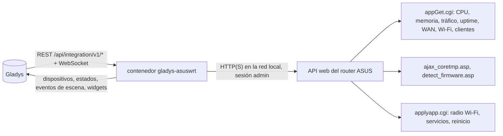
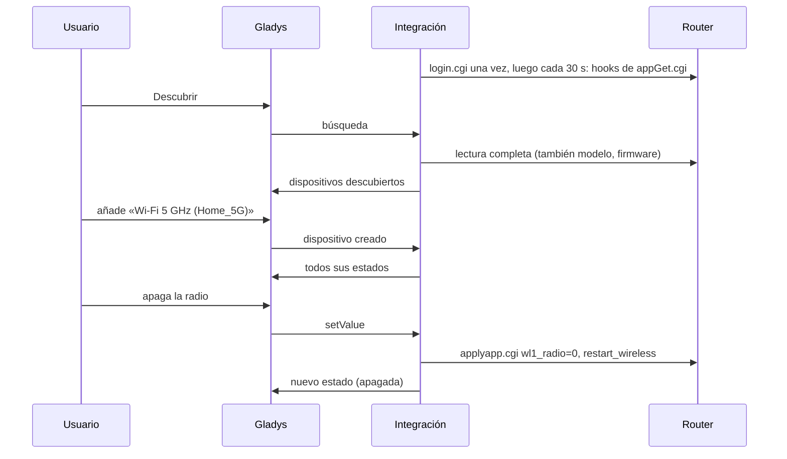
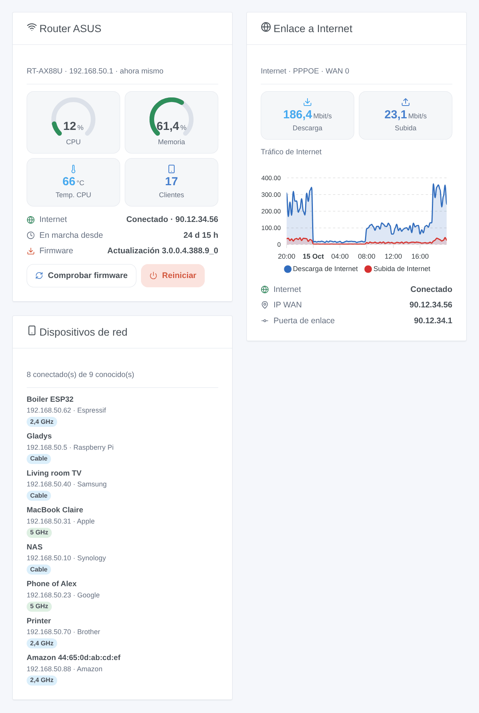

# Gladys ASUSWRT

[English](README.md) · [Français](README.fr.md) · [Deutsch](README.de.md) · **Español**

[](LICENSE)
[](https://github.com/William-De71/gladys-asuswrt/releases)
[](https://github.com/William-De71/gladys-asuswrt/actions/workflows/release.yml)
[](https://gladysassistant.com)


Integración externa de [Gladys Assistant](https://gladysassistant.com) para los **routers ASUS** (firmware ASUSWRT original y Asuswrt-Merlin): el estado del router, su enlace a Internet, sus radios Wi-Fi, los dispositivos presentes en su red, escenas y widgets del panel. Todo pasa por la interfaz web del router en su red local, con su cuenta de administrador: sin nube.

Documentación de usuario: [English](docs/en.md) · [Français](docs/fr.md) · [Deutsch](docs/de.md) · [Español](docs/es.md).

> Integración comunitaria, no afiliada ni respaldada por ASUSTeK Computer Inc. ni por el proyecto Asuswrt-Merlin.

## Funciones

- Dispositivo **router**: uso de CPU y memoria, temperaturas (CPU y cada radio que el router indica), tiempo en marcha, velocidad de descarga y subida de Internet, estado de Internet, dirección IP WAN, clientes conectados, versión del firmware.
- Un **interruptor por radio Wi-Fi** (2,4 GHz, 5 GHz, 6 GHz): apague el Wi-Fi de 5 GHz por la noche desde una escena.
- **Presencia** de los dispositivos de su red, según la lista de clientes del router, con un retardo de ausencia (como el rastreo de dispositivos de Home Assistant).
- **5 disparadores de escena**, **4 acciones de escena** y **3 widgets del panel** (abajo).
- Cuatro idiomas en todas partes: inglés, francés, alemán, español.

## Funcionamiento




De la búsqueda a una orden:



El cliente del router es una reescritura en JavaScript a partir de la biblioteca Python [asusrouter](https://github.com/Vaskivskyi/asusrouter) (Apache 2.0), la biblioteca HTTP de la integración ASUSWRT de Home Assistant. El modo SSH / Telnet de Home Assistant no es compatible.

### Transporte

`transports: ["local"]`: la integración solo habla con la interfaz web del router, por HTTP o HTTPS en su red. Con HTTPS, el certificado se verifica si marca «Verificar el certificado» (el router viene con uno autofirmado). Ningún dato sale de su red; el propio router contacta con el servidor de actualizaciones de ASUS al comprobar el firmware.

## Dispositivos y funciones

| Dispositivo        | Funciones (categoría / tipo)                                                                                                                                                                                                                    |
| ------------------ | ----------------------------------------------------------------------------------------------------------------------------------------------------------------------------------------------------------------------------------------------- |
| Router ASUS        | CPU, memoria (`level-sensor` %), temperaturas (`device-temperature-sensor`), tiempo en marcha (`duration`, días), descarga y subida (`datarate`, Mbit/s), Internet e IP WAN (`text`), clientes conectados (`counter-sensor`), firmware (`text`) |
| Radio Wi-Fi        | Radio (`switch` / `binary`, una orden: el router reinicia su Wi-Fi para aplicarla)                                                                                                                                                              |
| Dispositivo de red | Presencia (`presence-sensor` / `push`, 1 cada minuto mientras está presente, 0 al irse)                                                                                                                                                         |

Los identificadores externos se basan en identificadores estables: `main` para el router, la unidad inalámbrica (`wl0`, `wl1`…) para una radio, la dirección MAC para un cliente.

## Disparadores, acciones de escena y widgets



**Widgets**: Router ASUS (indicadores de CPU y memoria, temperatura, clientes, Internet, tiempo en marcha, firmware, botones «Comprobar firmware» y «Reiniciar»), Enlace a Internet (velocidades, gráfico del tráfico una vez añadido el dispositivo router, estado, dirección WAN), Dispositivos de red (conectados, idos o todos, con su conexión).

**Disparadores**: Internet caído o restablecido, dispositivo llegó o se fue, nuevo dispositivo en la red (una vez por dirección MAC, guardada en `/data`), router reiniciado, actualización de firmware disponible.

**Acciones**: leer el estado, reiniciar un servicio (Wi-Fi, conexión a Internet, DNS / DHCP), buscar una actualización de firmware, reiniciar.

Ejemplos:

- Cuando Internet se cae → apagar el enchufe inteligente del módem y volver a encenderlo 10 s después.
- Cuando el teléfono de un niño llega a la red → encender la luz de la entrada y enviar un mensaje.
- Cuando aparece un dispositivo nuevo en la red → enviar su nombre, fabricante e IP al administrador.

Un cambio hecho por la propia Gladys (una radio conmutada, un reinicio o una comprobación lanzados desde Gladys) nunca activa un disparador.

## Requisitos

- Gladys Assistant **5.1.0** o posterior (widgets y escenas): las instancias más antiguas no pueden instalar la integración.
- Un router ASUS con la interfaz web ASUSWRT (firmware original 3.0.0.4.386 o posterior, 3.0.0.6, o Asuswrt-Merlin), en modo router, y su cuenta de administrador. Los nodos AiMesh se excluyen de la lista de clientes (el router principal conoce todos los clientes).

## Instalación

- **Desde la tienda**: Integraciones → ASUSWRT → Instalar.
- **Desde la URL del repositorio**: Integraciones → integración externa → `https://github.com/William-De71/gladys-asuswrt`.
- **Modo desarrollador**: ejecute `npm start` con las variables que da Gladys (ver Desarrollo).

## Configuración

| Campo                          | Por defecto | Significado                                                          |
| ------------------------------ | ----------- | -------------------------------------------------------------------- |
| Dirección del router           | —           | `192.168.50.1` (http), o `https://192.168.50.1:8443` con HTTPS       |
| Nombre de usuario / Contraseña | —           | La cuenta de administrador del router (la contraseña es un `secret`) |
| Verificar el certificado       | desmarcado  | Solo HTTPS: márquelo con un certificado válido                       |
| Intervalo de lectura           | 30 s        | De 10 a 300 s                                                        |
| Dispositivos de red ofrecidos  | con nombre  | con nombre, todos, ninguno                                           |
| Retardo de ausencia            | 5 min       | De 1 a 60 min                                                        |
| Idioma de los textos           | automático  | Nombres, estados y resúmenes de escenas                              |

## Uso

1. Rellene la configuración y haga clic en **Probar la conexión**.
2. **Descubra**, y añada el router, las radios Wi-Fi y los dispositivos de red que desee.
3. Añada los widgets a un panel y cree escenas con los disparadores y las acciones.

## Desarrollo

```bash
npm install
npm test                       # node --test, nunca toca la red
npm run lint                   # ESLint
npm run format:check           # Prettier
npx github:GladysAssistant/integration-store . --skip-image-check
scripts/build-cover.sh         # cover.jpg desde docs/assets/cover.svg
docs/illustrations/render.sh   # docs/assets/widgets.<idioma>.png
```

En local, el SDK lee `GLADYS_HOST_API_URL`, `GLADYS_INTEGRATION_TOKEN` y `GLADYS_INTEGRATION_SELECTOR` (dados por Gladys en modo desarrollador). `DEBUG=gladys-integration-sdk` muestra los registros del SDK.

Las pruebas cubren el cliente del router (inicio de sesión, sesión conservada, sesión caducada, contraseña errónea, bloqueo de inicio de sesión), la lectura de respuestas reales de routers (volcados de la biblioteca asusrouter, JSON mal formado de firmwares antiguos), las transiciones y la presencia, los dispositivos (los campos que exige la pantalla de descubrimiento), los widgets (`validateWidgetContent`), los eventos y salidas de escena, el manifiesto, los cuatro idiomas, el script de release y la integración completa frente al Gladys falso del SDK y un router falso. `test/structure.test.js` congela todas las claves que guardan los usuarios.

## Proceso de release


Cada fusión en `main` lanza la CI y luego calcula la versión a partir de los [Conventional Commits](https://www.conventionalcommits.org/es/) desde la última etiqueta: `feat` → menor, `fix` / `perf` → parche, `!` o `BREAKING CHANGE` → mayor (una menor por debajo de 1.0.0); `docs`, `chore`, `ci`, `test`, `style`, `refactor`, `build` solos no publican nada. Se genera la sección del changelog, se envía la etiqueta, se construye la imagen multiarquitectura, luego `main` recibe el commit de release, se crea la GitHub Release y un último job comprueba la imagen pública, el validador de la tienda y el topic.

- El título de la pull request se convierte en el commit squash y luego en la línea del changelog: escríbalo en inglés, para el usuario (`pr-title.yml` lo comprueba). No edite nunca `CHANGELOG.md` a mano.
- 1.0.0 es una decisión: Actions → Release → Run workflow con `release-as: 1.0.0`. `dry-run` muestra la versión y las notas sin publicar.
- **Rama protegida**: la release envía su commit a `main` con `GITHUB_TOKEN`. Con un ruleset en `main`, añada GitHub Actions a su lista de omisión (o envíe mediante una GitHub App); si no, el job de publicación falla con instrucciones.
- Tras la primera release, haga público el paquete `ghcr.io` (Package settings → Change visibility), o Gladys no podrá descargarlo.

## Solución de problemas

Ver [docs/es.md](docs/es.md#solución-de-problemas). Informe de los problemas con las versiones de Gladys y de la integración, el modelo y el firmware del router, y los registros de la integración.

## Contribuir

Issues y pull requests bienvenidas. Ejecute `npm run format:check && npm run lint && npm test` antes de abrir una pull request, y mantenga sin cambios todos los identificadores externos y claves guardadas (ver [CLAUDE.md](CLAUDE.md)).

## Seguridad

Ver [SECURITY.md](SECURITY.md): informe de las vulnerabilidades en privado. La contraseña es un campo `secret`, nunca registrado ni puesto en una URL; la integración inicia sesión una vez, conserva su sesión y deja de intentarlo durante 15 minutos tras una contraseña rechazada, para que el router no bloquee la cuenta.

## Capturas por venir

Las imágenes de arriba son ilustraciones, no capturas de pantalla. Las capturas reales irán en `docs/assets/screenshots/` (PNG, 1280 × 800): `configuration.png`, `discovery.png`, `devices.png`, `scene.png`.

## Licencia

[Licencia Apache 2.0](LICENSE) — ver también [NOTICE](NOTICE). ASUS y ASUSWRT son marcas de ASUSTeK Computer Inc.; esta integración comunitaria no está afiliada a ella. Gracias a la documentación y al SDK de Gladys, y a la biblioteca asusrouter.
