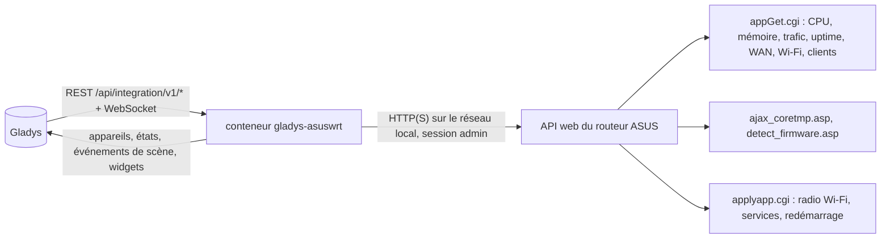
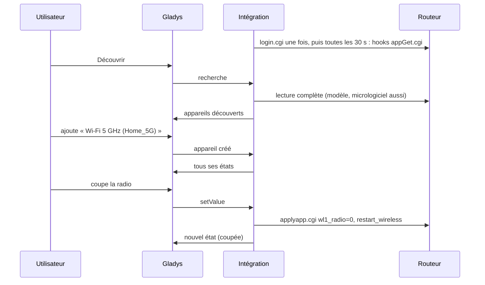
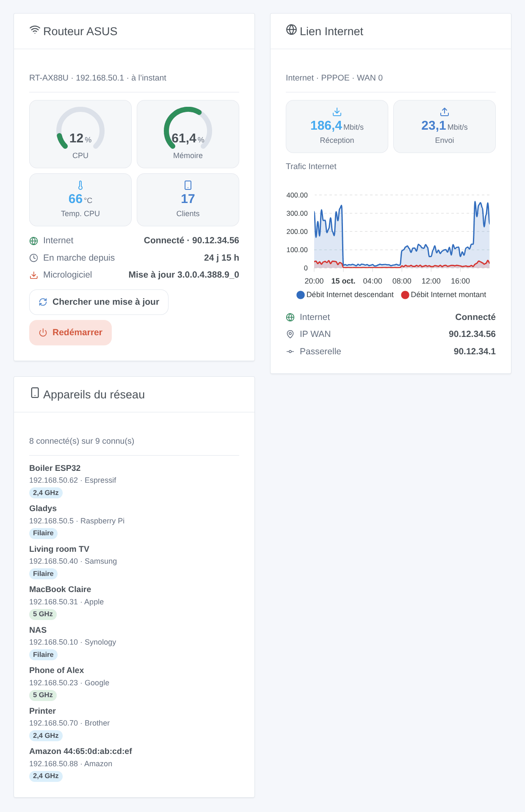

# Gladys ASUSWRT

[English](README.md) · **Français** · [Deutsch](README.de.md) · [Español](README.es.md)

[](LICENSE)
[](https://github.com/William-De71/gladys-asuswrt/releases)
[](https://github.com/William-De71/gladys-asuswrt/actions/workflows/release.yml)
[](https://gladysassistant.com)


Intégration externe [Gladys Assistant](https://gladysassistant.com) pour les **routeurs ASUS** (micrologiciel ASUSWRT d’origine et Asuswrt-Merlin) : la santé du routeur, son lien Internet, ses radios Wi-Fi, les appareils présents sur votre réseau, des scènes et des widgets de tableau de bord. Tout passe par l’interface web du routeur sur votre réseau local, avec son compte administrateur : aucun cloud.

Documentation utilisateur : [English](docs/en.md) · [Français](docs/fr.md) · [Deutsch](docs/de.md) · [Español](docs/es.md).

> Intégration communautaire, ni affiliée à ASUSTeK Computer Inc. ou au projet Asuswrt-Merlin, ni approuvée par eux.

## Fonctionnalités

- Appareil **routeur** : utilisation CPU et mémoire, températures (CPU et chaque radio que le routeur indique), temps de fonctionnement, débits Internet descendant et montant, état d’Internet, adresse IP WAN, clients connectés, version du micrologiciel.
- Un **interrupteur par radio Wi-Fi** (2,4 GHz, 5 GHz, 6 GHz) : coupez le Wi-Fi 5 GHz la nuit depuis une scène.
- **Présence** des appareils de votre réseau, d’après la liste des clients du routeur, avec un délai d’absence (comme le suivi d’appareils de Home Assistant).
- **5 déclencheurs de scène**, **4 actions de scène** et **3 widgets de tableau de bord** (ci-dessous).
- Quatre langues partout : anglais, français, allemand, espagnol.

## Fonctionnement




De la recherche à une commande :



Le client du routeur est une réécriture en JavaScript d’après la bibliothèque Python [asusrouter](https://github.com/Vaskivskyi/asusrouter) (Apache 2.0), la bibliothèque HTTP de l’intégration ASUSWRT de Home Assistant. Le mode SSH / Telnet de Home Assistant n’est pas pris en charge.

### Transport

`transports: ["local"]` : l’intégration ne dialogue qu’avec l’interface web du routeur, en HTTP ou HTTPS sur votre réseau. En HTTPS, le certificat est vérifié si vous cochez « Vérifier le certificat » (le routeur est livré avec un certificat auto-signé). Aucune donnée ne quitte votre réseau ; le routeur lui-même contacte le serveur de mises à jour d’ASUS lors d’une vérification du micrologiciel.

## Appareils et fonctionnalités

| Appareil        | Fonctionnalités (catégorie / type)                                                                                                                                                                                                                                     |
| --------------- | ---------------------------------------------------------------------------------------------------------------------------------------------------------------------------------------------------------------------------------------------------------------------- |
| Routeur ASUS    | CPU, mémoire (`level-sensor` %), températures (`device-temperature-sensor`), temps de fonctionnement (`duration`, jours), débits descendant et montant (`datarate`, Mbit/s), Internet et IP WAN (`text`), clients connectés (`counter-sensor`), micrologiciel (`text`) |
| Radio Wi-Fi     | Radio (`switch` / `binary`, une commande : le routeur redémarre son Wi-Fi pour l’appliquer)                                                                                                                                                                            |
| Appareil réseau | Présence (`presence-sensor` / `push`, 1 chaque minute tant qu’il est présent, 0 une fois parti)                                                                                                                                                                        |

Les identifiants externes reposent sur des identifiants stables : `main` pour le routeur, l’unité sans fil (`wl0`, `wl1`…) pour une radio, l’adresse MAC pour un client.

## Déclencheurs, actions de scène et widgets



**Widgets** : Routeur ASUS (jauges CPU et mémoire, température, clients, Internet, temps de fonctionnement, micrologiciel, boutons « Chercher une mise à jour » et « Redémarrer »), Lien Internet (débits, graphique du trafic une fois l’appareil routeur ajouté, état, adresse WAN), Appareils du réseau (connectés, partis ou tous, avec leur connexion).

**Déclencheurs** : Internet coupé ou rétabli, appareil arrivé ou parti, nouvel appareil sur le réseau (une fois par adresse MAC, mémorisée dans `/data`), routeur redémarré, mise à jour du micrologiciel disponible.

**Actions** : lire l’état, redémarrer un service (Wi-Fi, connexion Internet, DNS / DHCP), vérifier les mises à jour du micrologiciel, redémarrer.

Exemples :

- Quand Internet est coupé → éteindre la prise connectée de la box et la rallumer 10 s plus tard.
- Quand le téléphone d’un enfant arrive sur le réseau → allumer la lumière de l’entrée et envoyer un message.
- Quand un nouvel appareil apparaît sur le réseau → envoyer son nom, son fabricant et son IP à l’administrateur.

Un changement fait par Gladys elle-même (une radio basculée, un redémarrage ou une vérification lancés depuis Gladys) ne déclenche jamais de scène.

## Prérequis

- Gladys Assistant **5.3.0** ou plus récent (mots-clés et pays du catalogue, widgets et scènes) : les instances plus anciennes ne peuvent pas installer l’intégration.
- Un routeur ASUS avec l’interface web ASUSWRT (micrologiciel d’origine 3.0.0.4.386 ou plus récent, 3.0.0.6, ou Asuswrt-Merlin), en mode routeur, et son compte administrateur. Les nœuds AiMesh sont exclus de la liste des clients (le routeur principal connaît tous les clients).

## Installation

- **Depuis le store** : Intégrations → ASUSWRT → Installer.
- **Depuis l’URL du dépôt** : Intégrations → intégration externe → `https://github.com/William-De71/gladys-asuswrt`.
- **Mode développeur** : lancez `npm start` avec les variables fournies par Gladys (voir Développement).

## Configuration

| Champ                            | Par défaut  | Rôle                                                                  |
| -------------------------------- | ----------- | --------------------------------------------------------------------- |
| Adresse du routeur               | —           | `192.168.50.1` (http), ou `https://192.168.50.1:8443` avec le HTTPS   |
| Nom d’utilisateur / Mot de passe | —           | Le compte administrateur du routeur (le mot de passe est un `secret`) |
| Vérifier le certificat           | décoché     | HTTPS seulement : cochez-le avec un certificat valide                 |
| Intervalle de lecture            | 30 s        | De 10 à 300 s                                                         |
| Appareils du réseau proposés     | avec un nom | avec un nom, tous, aucun                                              |
| Délai d’absence                  | 5 min       | De 1 à 60 min                                                         |
| Langue des textes                | automatique | Noms, états et résumés des scènes                                     |

## Utilisation

1. Remplissez la configuration, puis cliquez sur **Tester la connexion**.
2. **Découvrez**, puis ajoutez le routeur, les radios Wi-Fi et les appareils du réseau souhaités.
3. Ajoutez les widgets à un tableau de bord, et créez des scènes avec les déclencheurs et les actions.

## Développement

```bash
npm install
npm test                       # node --test, ne touche jamais le réseau
npm run lint                   # ESLint
npm run format:check           # Prettier
npx github:GladysAssistant/integration-store . --skip-image-check
scripts/build-cover.sh         # cover.jpg depuis docs/assets/cover.svg
docs/illustrations/render.sh   # docs/assets/widgets.<langue>.png
```

En local, le SDK lit `GLADYS_HOST_API_URL`, `GLADYS_INTEGRATION_TOKEN` et `GLADYS_INTEGRATION_SELECTOR` (fournis par Gladys en mode développeur). `DEBUG=gladys-integration-sdk` affiche les journaux du SDK.

Les tests couvrent le client du routeur (connexion, session conservée, session expirée, mauvais mot de passe, blocage de connexion), la lecture de vraies réponses de routeurs (relevés de la bibliothèque asusrouter, JSON mal formé des anciens micrologiciels), les transitions et la présence, les appareils (les champs exigés par l’écran de découverte), les widgets (`validateWidgetContent`), les événements et sorties de scène, le manifeste, les quatre langues, le script de release, et l’intégration complète face au faux Gladys du SDK et à un faux routeur. `test/structure.test.js` fige toutes les clés stockées chez les utilisateurs.

## Processus de release


Chaque fusion sur `main` lance la CI, puis calcule la version d’après les [Conventional Commits](https://www.conventionalcommits.org/fr/) depuis le dernier tag : `feat` → mineure, `fix` / `perf` → correctif, `!` ou `BREAKING CHANGE` → majeure (une mineure tant qu’on est sous 1.0.0) ; `docs`, `chore`, `ci`, `test`, `style`, `refactor`, `build` seuls ne publient rien. La section du changelog est générée, le tag poussé, l’image multi-architecture construite, puis `main` reçoit le commit de release, la GitHub Release est créée et un dernier job vérifie l’image publique, le validateur du store et le topic.

- Le titre de la pull request devient le commit squash, puis la ligne du changelog : écrivez-le en anglais, pour l’utilisateur (`pr-title.yml` le vérifie). N’éditez jamais `CHANGELOG.md` à la main.
- 1.0.0 est une décision : Actions → Release → Run workflow avec `release-as: 1.0.0`. `dry-run` affiche la version et les notes sans rien publier.
- **Branche protégée** : la release pousse son commit sur `main` avec `GITHUB_TOKEN`. Avec une règle sur `main`, ajoutez GitHub Actions à sa liste de contournement (ou poussez via une GitHub App), sinon le job de publication échoue avec des instructions.
- Après la première release, rendez public le package `ghcr.io` (Package settings → Change visibility), sinon Gladys ne peut pas le télécharger.

## Dépannage

Voir [docs/fr.md](docs/fr.md#dépannage). Signalez les problèmes avec les versions de Gladys, de l’intégration, le modèle et le micrologiciel du routeur, et les journaux de l’intégration.

## Contribuer

Issues et pull requests bienvenues. Lancez `npm run format:check && npm run lint && npm test` avant d’ouvrir une pull request, et gardez inchangés tous les identifiants externes et clés stockées (voir [CLAUDE.md](CLAUDE.md)).

## Sécurité

Voir [SECURITY.md](SECURITY.md) : signalez les vulnérabilités en privé. Le mot de passe est un champ `secret`, jamais journalisé ni mis dans une URL ; l’intégration se connecte une fois et garde sa session, et arrête d’essayer pendant 15 minutes après un mot de passe refusé, pour que le routeur ne bloque pas le compte.

## Captures à venir

Les images ci-dessus sont des illustrations, pas des captures d’écran. Les vraies captures iront dans `docs/assets/screenshots/` (PNG, 1280 × 800) : `configuration.png`, `discovery.png`, `devices.png`, `scene.png`.

## Licence

[Licence Apache 2.0](LICENSE) — voir aussi [NOTICE](NOTICE). ASUS et ASUSWRT sont des marques d’ASUSTeK Computer Inc. ; cette intégration communautaire n’y est pas affiliée. Merci à la documentation et au SDK de Gladys, et à la bibliothèque asusrouter.
