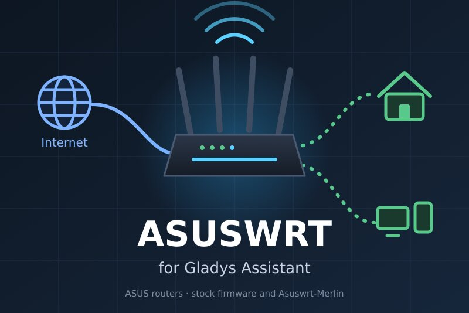
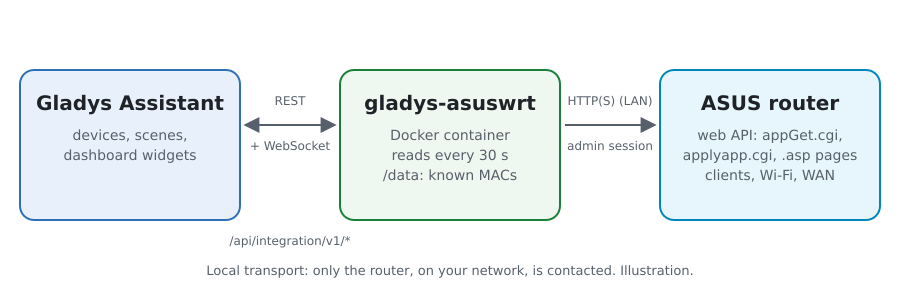
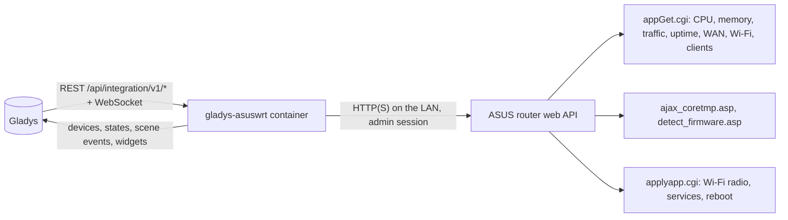
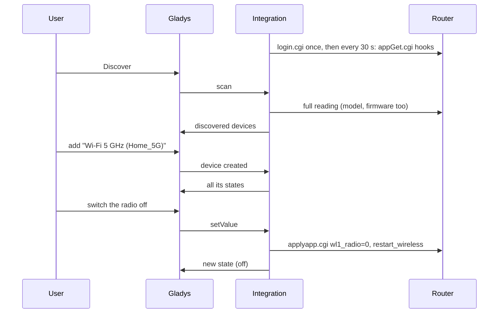
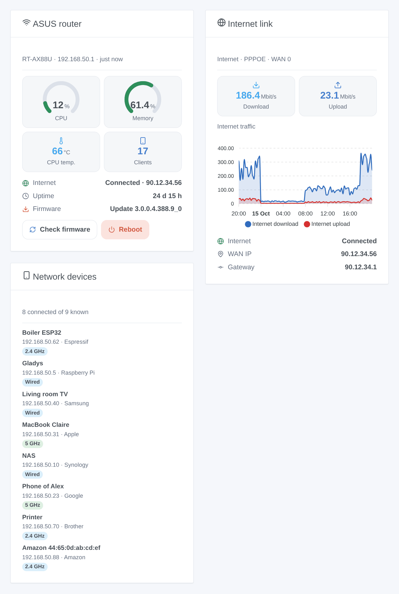

# Gladys ASUSWRT

**English** · [Français](README.fr.md) · [Deutsch](README.de.md) · [Español](README.es.md)

[](LICENSE)
[](https://github.com/William-De71/gladys-asuswrt/releases)
[](https://github.com/William-De71/gladys-asuswrt/actions/workflows/release.yml)
[](https://gladysassistant.com)



[Gladys Assistant](https://gladysassistant.com) external integration for **ASUS routers** (stock ASUSWRT firmware and Asuswrt-Merlin): the health of the router, its internet link, its Wi-Fi radios, the devices present on your network, scenes and dashboard widgets. Everything goes through the web interface of the router on your local network, with its administrator account: no cloud.

User documentation: [English](docs/en.md) · [Français](docs/fr.md) · [Deutsch](docs/de.md) · [Español](docs/es.md).

> Community integration, not affiliated with nor endorsed by ASUSTeK Computer Inc. or the Asuswrt-Merlin project.

## Features

- **Router** device: CPU and memory usage, temperatures (CPU and each radio the router reports), uptime, internet download and upload rates, internet status, WAN IP address, connected clients, firmware version.
- A **switch per Wi-Fi radio** (2.4 GHz, 5 GHz, 6 GHz): turn the 5 GHz Wi-Fi off at night from a scene.
- **Presence** of the devices of your network, from the client list of the router, with an absence delay (like the Home Assistant device tracker).
- **5 scene triggers**, **4 scene actions** and **3 dashboard widgets** (below).
- Four languages everywhere: English, French, German, Spanish.

## How it works





From the scan to a command:



The router client is a JavaScript rewrite after the [asusrouter](https://github.com/Vaskivskyi/asusrouter) Python library (Apache 2.0), the HTTP library of the Home Assistant ASUSWRT integration. The SSH / Telnet mode of Home Assistant is not supported.

### Transport

`transports: ["local"]`: the integration only talks to the web interface of the router, over HTTP or HTTPS on your network. With HTTPS, the certificate is checked when you tick "Verify the certificate" (the router ships with a self-signed one). No data leaves your network; the router itself contacts the ASUS update server during a firmware check.

## Devices and features

| Device         | Features (category / type)                                                                                                                                                                                                             |
| -------------- | -------------------------------------------------------------------------------------------------------------------------------------------------------------------------------------------------------------------------------------- |
| ASUS router    | CPU, memory (`level-sensor` %), temperatures (`device-temperature-sensor`), uptime (`duration`, days), download and upload (`datarate`, Mbit/s), internet and WAN IP (`text`), connected clients (`counter-sensor`), firmware (`text`) |
| Wi-Fi radio    | Radio (`switch` / `binary`, a command: the router restarts its Wi-Fi to apply it)                                                                                                                                                      |
| Network device | Presence (`presence-sensor` / `push`, 1 every minute while present, 0 once gone)                                                                                                                                                       |

External ids rest on stable identifiers: `main` for the router, the wireless unit (`wl0`, `wl1`...) for a radio, the MAC address for a client.

## Scene triggers, actions and widgets



**Widgets**: ASUS router (CPU and memory gauges, temperature, clients, internet, uptime, firmware, "check firmware" and "reboot" buttons), Internet link (rates, traffic chart once the router device is added, link, WAN address), Network devices (connected, gone or all, with their connection).

**Triggers**: internet down or back, device arrived or left, new device on the network (once per MAC address, remembered in `/data`), router rebooted, firmware update available.

**Actions**: read the status, restart a service (Wi-Fi, internet connection, DNS / DHCP), check for a firmware update, reboot.

Examples:

- When the internet goes down → turn the box's smart plug off and on again after 10 s.
- When the phone of a child arrives on the network → turn the hall light on and send a message.
- When a new device appears on the network → send its name, maker and IP to the administrator.

A change made by Gladys itself (a radio switched, a reboot or a firmware check run from Gladys) never fires a trigger.

## Requirements

- Gladys Assistant **5.3.0** or later (catalog keywords and countries, widgets and scenes): older instances cannot install the integration.
- An ASUS router with the ASUSWRT web interface (stock firmware 3.0.0.4.386 or later, 3.0.0.6, or Asuswrt-Merlin), in router mode, and its administrator account. AiMesh nodes are left out of the client list (the main router knows every client).

## Installation

- **From the store**: Integrations → ASUSWRT → Install.
- **From the repository URL**: Integrations → external integration → `https://github.com/William-De71/gladys-asuswrt`.
- **Developer mode**: run `npm start` with the variables given by Gladys (see Development).

## Configuration

| Field                   | Default     | Meaning                                                              |
| ----------------------- | ----------- | -------------------------------------------------------------------- |
| Router address          | —           | `192.168.50.1` (http), or `https://192.168.50.1:8443` with HTTPS     |
| User name / Password    | —           | The administrator account of the router (the password is a `secret`) |
| Verify the certificate  | off         | HTTPS only: tick it with a valid certificate                         |
| Reading interval        | 30 s        | 10 to 300 s                                                          |
| Network devices offered | with a name | with a name, all, none                                               |
| Absence delay           | 5 min       | 1 to 60 min                                                          |
| Language of the texts   | automatic   | Names, states and scene summaries                                    |

## Usage

1. Fill in the configuration, then click **Test the connection**.
2. **Discover**, then add the router, the Wi-Fi radios and the network devices you want.
3. Add the widgets to a dashboard, and build scenes with the triggers and actions.

## Development

```bash
npm install
npm test                       # node --test, never touches the network
npm run lint                   # ESLint
npm run format:check           # Prettier
npx github:GladysAssistant/integration-store . --skip-image-check
scripts/build-cover.sh         # cover.jpg from docs/assets/cover.svg
docs/illustrations/render.sh   # docs/assets/widgets.<lang>.png
```

Locally, the SDK reads `GLADYS_HOST_API_URL`, `GLADYS_INTEGRATION_TOKEN` and `GLADYS_INTEGRATION_SELECTOR` (given by Gladys in developer mode). `DEBUG=gladys-integration-sdk` shows the SDK logs.

The tests cover the router client (login, kept session, expired session, wrong password, login lock), the reading of real router answers (dumps of the asusrouter library, malformed JSON of old firmwares), the transitions and the presence, the devices (the fields the Discovery screen requires), the widgets (`validateWidgetContent`), the scene events and outputs, the manifest, the four languages, the release script, and the whole integration against the fake Gladys of the SDK and a fake router. `test/structure.test.js` freezes every key users store.

## Release process


Every merge on `main` runs the CI, then computes the version from the [Conventional Commits](https://www.conventionalcommits.org/) since the last tag: `feat` → minor, `fix` / `perf` → patch, `!` or `BREAKING CHANGE` → major (a minor below 1.0.0); `docs`, `chore`, `ci`, `test`, `style`, `refactor`, `build` alone publish nothing. The changelog section is generated, the tag pushed, the multi-architecture image built, then `main` receives the release commit, the GitHub Release is created and a last job checks the public image, the store validator and the topic.

- The pull request title becomes the squash commit, then the changelog line: write it in English, for the user (`pr-title.yml` checks it). Never edit `CHANGELOG.md` by hand.
- 1.0.0 is a decision: Actions → Release → Run workflow with `release-as: 1.0.0`. `dry-run` shows the version and the notes without publishing.
- **Protected branch**: the release pushes its commit to `main` with `GITHUB_TOKEN`. With a ruleset on `main`, add GitHub Actions to its bypass list (or push through a GitHub App), otherwise the publish job fails with instructions.
- After the first release, make the `ghcr.io` package public (Package settings → Change visibility), or Gladys cannot pull it.

## Troubleshooting

See [docs/en.md](docs/en.md#troubleshooting). Report issues with the versions of Gladys, of the integration, the model and firmware of the router, and the logs of the integration.

## Contributing

Issues and pull requests are welcome. Run `npm run format:check && npm run lint && npm test` before opening a pull request, and keep every external id and stored key unchanged (see [CLAUDE.md](CLAUDE.md)).

## Security

See [SECURITY.md](SECURITY.md): report vulnerabilities privately. The password is a `secret` field, never logged nor put in an URL; the integration logs in once and keeps its session, and stops trying for 15 minutes after a refused password, so that the router does not lock the account.

## Screenshots to come

The images above are illustrations, not screenshots. Real screenshots will go in `docs/assets/screenshots/` (PNG, 1280 × 800): `configuration.png`, `discovery.png`, `devices.png`, `scene.png`.

## License

[Apache License 2.0](LICENSE) — see also [NOTICE](NOTICE). ASUS and ASUSWRT are trademarks of ASUSTeK Computer Inc.; this community integration is not affiliated with it. Thanks to the Gladys documentation and SDK, and to the asusrouter library.
